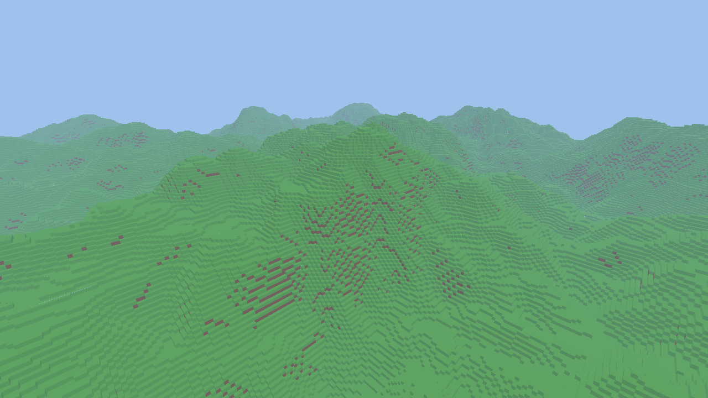

# Espresso Voxel Engine

A performance-first voxel engine in Rust on wgpu 30. Third attempt after Decaf and Lemon (see `docs/HISTORY.md`).

```sh
cargo run --release -- --radius 16       # fly-cam: click to grab mouse, WASD, Space/Ctrl, Shift = fast
cargo run --release -- --screenshot out.png
cargo probe                              # adapter, features, render tier
cargo test --workspace && cargo bench-cpu
```



Start with `AGENTS.md`, then `docs/ARCHITECTURE.md`, `docs/ROADMAP.md` and `docs/PERFORMANCE.md`.
